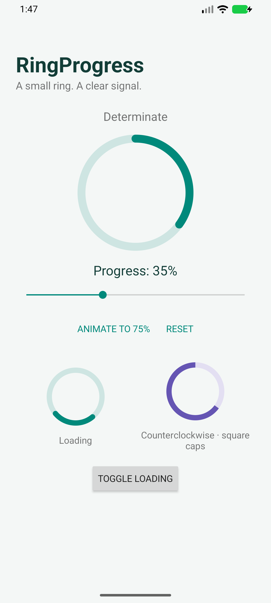

# RingProgress

一个轻量的 Android 圆环进度条。Kotlin 编写，原生 View，支持 XML、Java、Kotlin 和 Compose `AndroidView`。Android 6.0（API 23）及以上。



## 特性

- 确定进度与不确定加载动画；顺时针 / 逆时针、圆角 / 平角、颜色与线宽。
- `wrap_content` 默认 96dp，支持 padding、非正方形约束和尺寸变化。
- 动画连续转向新目标；不可见、离开窗口时停止；恢复显示后重新开始加载动画。
- 状态保存与恢复，TalkBack ProgressBar 范围语义；尊重系统关闭动画设置。
- 不申请权限，不包含网络、图片、闪光依赖或业务逻辑。库的运行时依赖只有 Kotlin 标准库。

## 接入

目前仓库提供源码和 Maven Local 发布，**尚未发布到 Maven Central**。

直接在本项目中引用：

```kotlin
dependencies { implementation(project(":ringprogress")) }
```

或先在此仓库执行 `./gradlew :ringprogress:publishToMavenLocal`，再在消费项目加入 `mavenLocal()` 和：

```kotlin
implementation("io.github.stormblue:ringprogress:2.0.0")
```

发布包含 release AAR、源码 JAR 和 Maven POM。不要向提交中添加仓库凭据；远程发布需要维护者另行配置。

## XML

```xml
<io.github.stormblue.ringprogress.RingProgressView
    xmlns:android="http://schemas.android.com/apk/res/android"
    xmlns:app="http://schemas.android.com/apk/res-auto"
    android:id="@+id/progress"
    android:layout_width="120dp"
    android:layout_height="120dp"
    android:contentDescription="下载进度"
    app:ringMax="100"
    app:ringProgress="35"
    app:ringStrokeWidth="8dp"
    app:ringProgressColor="#00897B" />
```

```kotlin
ring.progress = 40f                     // 立即更新
ring.setProgress(75f, animated = true)   // 默认 300ms，从当前显示位置过渡
ring.isIndeterminate = true             // 加载状态：90° 圆弧，每 1200ms 转一圈
ring.isIndeterminate = false            // 显示最近设置的 progress
```

Java：`ring.setProgress(75f, true); ring.setIndeterminate(true);`

在主线程修改参数。加载模式下可以更新目标进度，切回确定模式时显示它。组件自身不绘制文字，可在容器中叠加 TextView。

## 参数

| Kotlin 属性 | XML 属性 | 默认值 / 规则 |
| --- | --- | --- |
| `progress` | `ringProgress` | `0f`；有限数，限制到 `[0, max]` |
| `max` | `ringMax` | `100f`；有限且大于 0；缩小时同步限制进度 |
| `strokeWidth` | `ringStrokeWidth` | 8dp；Kotlin/Java API 单位 **px**，有限且大于 0；绘制时限制为可用直径的一半 |
| `progressColor` | `ringProgressColor` | `#00897B`，ARGB 颜色整数 |
| `trackColor` | `ringTrackColor` | `#2800897B`，ARGB 颜色整数 |
| `startAngle` | `ringStartAngle` | `-90f`，从顶部开始；0° 在右侧，正角度顺时针 |
| `clockwise` | `ringClockwise` | `true`，不随 RTL 自动反向 |
| `roundedCaps` | `ringRoundedCaps` | `true` |
| `isIndeterminate` | `ringIndeterminate` | `false` |
| `animationDuration` | `ringAnimationDuration` | `300` 毫秒，非负；0 表示立即更新，仅影响确定进度过渡 |

非法参数（NaN、无穷、非正 max/线宽、负时长）抛出 `IllegalArgumentException`。`progress` 返回目标值，动画中显示值逐帧追赶目标。状态恢复需要设置稳定的 `android:id`；恢复目标和样式，动画不续播旧时间线。

## Compose 接入（可选）

组件不引入 Compose；已有 Compose 项目可使用官方互操作容器：

```kotlin
AndroidView(
    factory = { context -> RingProgressView(context) },
    modifier = Modifier.size(120.dp),
    update = { view -> view.setProgress(progress, animated = true) },
)
```

`AndroidView` 来自 `androidx.compose.ui.viewinterop`。不要在每次重组中重复启用过渡；若状态更新频繁，使用 `view.progress = progress`，让调用方控制动画。

## 性能取舍

保留硬件加速 Canvas View。换成 Compose 不会自动改善简单圆弧的性能；核心绘制只需一次轨道椭圆和一次进度圆弧，`Paint` / `RectF` 复用，`onDraw` 内无显式对象分配、无 Bitmap、无遮罩和离屏画布。进度变化不触发布局，静止时不主动刷新；动画使用平台帧时钟，隐藏和 detach 后取消。

这是针对旧实现的结构优化，**没有可比较的旧版本跑分，不声称提升百分比**。实际表现取决于设备、屏幕刷新率和调用方式。参见 [验证记录](docs/verification.md) 与 [Google 自定义 View 优化建议](https://developer.android.com/develop/ui/views/layout/custom-views/optimizing-view)。

## 构建与示例

依赖版本于 2026-11-14 核对官方发布源：AGP 9.5.1、Gradle 9.9.1、Kotlin 2.4.21；compile/target SDK 37。AGP 内置 Kotlin，根构建脚本将编译器更新至稳定版，无需额外 Android Kotlin 插件。

使用 JDK 17 或更高版本（本机验证为 JDK 25），安装 Android SDK Platform 37 与 Build Tools 36.0.0，在 `local.properties` 设置 `sdk.dir` 或导出 `ANDROID_HOME`。

```sh
./gradlew :app:assembleDebug :app:assembleRelease :ringprogress:assembleRelease lint
./gradlew :app:installDebug
./gradlew :ringprogress:connectedDebugAndroidTest
./gradlew :ringprogress:publishToMavenLocal
```

示例包含可拖动的确定进度、动画到 75%、重置、加载开关、逆时针平角样式；支持系统栏 Insets、旋转恢复。库测试覆盖参数边界、像素绘制、测量、保存恢复、无障碍和动画可见性生命周期。

## 从旧项目迁移

2.0 是一次不兼容整理：模块 `marqueeview` 改为 `ringprogress`，包名改为 `io.github.stormblue.ringprogress`。原仓库混合了 `MarqueeView`、`ShimmerMarqueeView`、`ShimmerFrameLayout`、`HJJTZXMeterView` 等跑马灯 / 闪光 / 位图仪表盘实验；它们与本次圆环 API 不同，已移除，不提供同名兼容壳。旧代码和资源仍可从 Git 历史取回。新项目只维护一个圆环组件和一个示例 App。

## 许可证

[Apache License 2.0](LICENSE)。欢迎提交问题和小而聚焦的 PR；提交前运行构建、lint，并为公共行为的改动运行设备测试。
