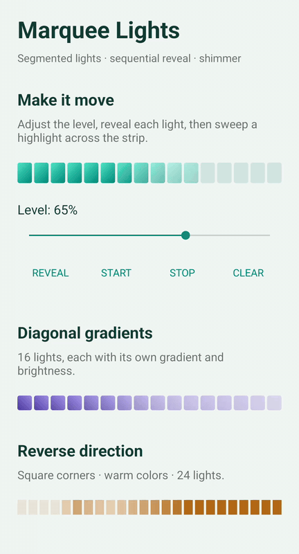

# MarqueeView

轻量的 Android 分段灯带跑马灯组件：逐段点亮、逐灯亮度和循环扫光。Kotlin 原生 View，支持 XML、Java、Kotlin 与 Compose `AndroidView`，最低 Android 6.0（API 23）。



演示包含逐段点亮、斜向渐变、扫光、停止 / 恢复和亮度调节。[查看静态截图](docs/sample.png)。

## 特性

- 默认 16 段灯块，可配置 1–256 段、间距、圆角与颜色。
- 每段可使用独立重起的斜向渐变，支持起止颜色和任意角度。
- 独立设置每一段的亮度，也可用 `progress` 顺序点亮。
- 从当前亮度逐段过渡至新目标，完成后按需循环扫光。
- 自动跟随 RTL；支持反向播放、padding 和动态尺寸。
- 隐藏、进入后台或移出窗口时取消动画，恢复可见后按播放意图重启扫光。
- 保存亮度、样式与播放意图，提供无障碍进度语义，尊重系统关闭动画设置。
- 运行时仅依赖 Kotlin 标准库，不申请权限。

## 接入

`main` 包含组件库 `marqueeview` 和示例 `app`。

本项目中直接引用：

```kotlin
dependencies { implementation(project(":marqueeview")) }
```

也可在此仓库执行 `./gradlew :marqueeview:publishToMavenLocal`，在消费项目的仓库配置中加入 `mavenLocal()` 后引用：

```kotlin
implementation("io.github.stormblue:marqueeview:2.0.0")
```

目前提供源码与 Maven Local 发布，尚未发布到 Maven Central。发布产物包含 release AAR、源码 JAR、POM 和 Gradle module metadata。

## XML

```xml
<io.github.stormblue.marqueeview.MarqueeView
    xmlns:android="http://schemas.android.com/apk/res/android"
    xmlns:app="http://schemas.android.com/apk/res-auto"
    android:id="@+id/marquee"
    android:layout_width="match_parent"
    android:layout_height="24dp"
    android:contentDescription="设备信号强度"
    app:marqueeSegmentCount="16"
    app:marqueeSegmentSpacing="3dp"
    app:marqueeProgress="0.65"
    app:marqueeGradientEnabled="true"
    app:marqueeGradientStartColor="#58F7B0"
    app:marqueeGradientEndColor="#00897B"
    app:marqueeGradientAngle="45"
    app:marqueeAutoStart="true" />
```

## Kotlin / Java

所有修改在主线程进行。

```kotlin
marquee.gradientEnabled = true
marquee.gradientStartColor = Color.rgb(88, 247, 176)
marquee.gradientEndColor = Color.rgb(0, 137, 123)
marquee.gradientAngle = 45f               // 每段左上 → 右下
marquee.progress = 0.5f                  // 前一半灯块点亮
marquee.setProgress(0.75f, true)          // 从当前亮度逐段过渡
marquee.start()                          // 过渡结束后循环扫光
marquee.stop()                           // 停止动画，保留目标亮度

// 每段独立亮度，顺序为逻辑起点至终点；输入会复制。
marquee.setIntensities(
    FloatArray(marquee.segmentCount) { 1f - it.toFloat() / marquee.segmentCount },
    animated = true,
)

// 清空灯带
marquee.stop()
marquee.progress = 0f
```

```java
marquee.setProgress(0.75f, true);
marquee.setSegmentCount(4);
marquee.setIntensities(new float[] { 1f, 0.8f, 0.4f, 0f });
marquee.start();
marquee.stop();
```

`start()` 记录播放意图；全暗、不可见、未挂载或系统关闭动画时不启动循环。`isStarted` 表示播放意图，`isRunning` 表示当前是否有逐段过渡或扫光动画。隐藏或移出窗口会结束未完成的亮度过渡并保留目标值，再显示时按播放意图启动扫光。`stop()` 同样显示最终目标亮度。

给 View 设置稳定 `android:id` 后可自动保存与恢复状态；恢复目标值及样式，动画从新的时间线开始。组件本身不绘制文字，内容描述由调用方设置；无障碍范围值为所有灯块的平均目标亮度。

## 参数

| Kotlin 属性 | XML 属性 | 默认值 / 规则 |
| --- | --- | --- |
| `segmentCount` | `marqueeSegmentCount` | 16；1–256，改变数量时清空亮度并取消当前动画，保留播放意图 |
| `segmentSpacing` | `marqueeSegmentSpacing` | 3dp；非负，程序 API 单位 **px** |
| `cornerRadius` | `marqueeCornerRadius` | 3dp；非负，程序 API 单位 **px**；0 为直角 |
| `lightColor` | `marqueeLightColor` | `#00F5AA`，纯色模式的点亮颜色 |
| `gradientEnabled` | `marqueeGradientEnabled` | false；启用每段独立渐变 |
| `gradientStartColor` | `marqueeGradientStartColor` | `#58F7B0` |
| `gradientEndColor` | `marqueeGradientEndColor` | `#52E3A3` |
| `gradientAngle` | `marqueeGradientAngle` | 45°；0° 向右、90° 向下、135° 从右上到左下，接受有限角度并归一化 |
| `trackColor` | `marqueeTrackColor` | `#0D432F` |
| `shimmerColor` | `marqueeShimmerColor` | `#FFFFFF` |
| `shimmerWidth` | `marqueeShimmerWidth` | 0.3；扫光半宽占灯带比例，范围 `(0, 1]` |
| `shimmerDuration` | `marqueeShimmerDuration` | 1600ms；大于 0，完整扫过一次的时长 |
| `revealDuration` | `marqueeRevealDuration` | 400ms；非负，0 表示立即更新亮度 |
| `reverseDirection` | `marqueeReverseDirection` | false；反转逻辑方向；默认 LTR 向右、RTL 向左 |
| `progress` | `marqueeProgress` | 0；有限数，限制到 `[0, 1]`；不足一整段时按比例设置该段亮度 |
| — | `marqueeAutoStart` | false；初始化时调用 `start()` |
| `intensities`（只读副本） | — | 每段亮度 `[0, 1]`，通过 `setIntensities()` 修改 |
| `isStarted` / `isRunning`（只读） | — | 播放意图 / 当前实际动画状态 |

亮度数组长度必须等于 `segmentCount`，每项必须为 `[0, 1]` 的有限数。非法数量、尺寸、时长、NaN 或无穷值会抛出 `IllegalArgumentException`。

`wrap_content` 默认 240 × 12dp，再加 padding，遵循父布局的约束。灯块填满可用高度与宽度；间距会限制到可用空间，宽度不足时安全跳过绘制。RTL 需要宿主应用设置 `android:supportsRtl="true"`。

## Compose（可选）

已有 Compose 项目可以使用官方互操作容器，组件不强制引入 Compose：

```kotlin
AndroidView(
    factory = { context -> MarqueeView(context).apply { start() } },
    modifier = Modifier.fillMaxWidth().height(24.dp),
    update = { view -> view.progress = progress },
)
```

`AndroidView` 来自 `androidx.compose.ui.viewinterop`。需要逐段过渡时，在目标变化时调用 `setProgress(value, true)`。

## 性能

灯块直接使用硬件加速 Canvas 绘制。纯色模式每段每帧一次 `drawRoundRect`；渐变模式绘制底色、渐变亮度层和按需出现的扫光层，最多三次。每个灯块的 `LinearGradient` 按自身边界创建并缓存，只在尺寸、padding 或渐变相关参数变化时重建。动画帧复用 Shader、`Paint` 与亮度缓冲区，`onDraw` 没有显式对象分配，不创建 Shader / Matrix / Bitmap，不使用离屏遮罩，不输出逐帧日志。逐段过渡和扫光共用一个动画槽，最多一个 `ValueAnimator` 运行；数据变化不触发布局。

全暗、停止或隐藏时不维持刷新循环。段数限制为 256，避免无界绘制开销。真实表现取决于设备和调用方式，测量条件及结果见 [验证记录](docs/verification.md)。实现遵循 [Google 自定义 View 优化建议](https://developer.android.com/develop/ui/views/layout/custom-views/optimizing-view)。

## 构建与测试

工具链：AGP 9.5.1、Gradle 9.9.1、Kotlin 2.4.21，compile/target SDK 37。AGP 内置 Kotlin，根脚本指定编译器版本；不应用额外 Android Kotlin 插件。使用 JDK 17 或更高版本（本机验证 JDK 25），安装 Android SDK Platform 37 和 Build Tools 36.0.0，设置 `local.properties` 的 `sdk.dir` 或 `ANDROID_HOME`。

```sh
./gradlew :app:assembleDebug :app:assembleRelease :marqueeview:assembleRelease lint
./gradlew :app:installDebug
./gradlew :marqueeview:connectedDebugAndroidTest :app:connectedDebugAndroidTest --no-parallel
./gradlew :marqueeview:publishToMavenLocal
```

示例包含亮度滑杆、逐段点亮、开始 / 停止 / 清空、45° / 135° 逐段渐变、逐灯亮度和反向扫光。设备测试覆盖参数、每段渐变方向与颜色、动画中 Shader 缓存复用、像素绘制、RTL、测量、数组隔离、保存恢复、无障碍、XML、动画转向和生命周期。GitHub Actions 编译示例和测试 APK、运行 lint 并检查本地发布；设备测试可在连接的设备 / AVD 上运行。多项目共享模拟器时，使用 `ANDROID_SERIAL=设备序列号` 选择专用设备；测试涉及系统动画开关并会恢复其原值。

## 许可证

[Apache License 2.0](LICENSE)。欢迎提交小而聚焦的 PR，修改公共行为时请运行设备测试。
